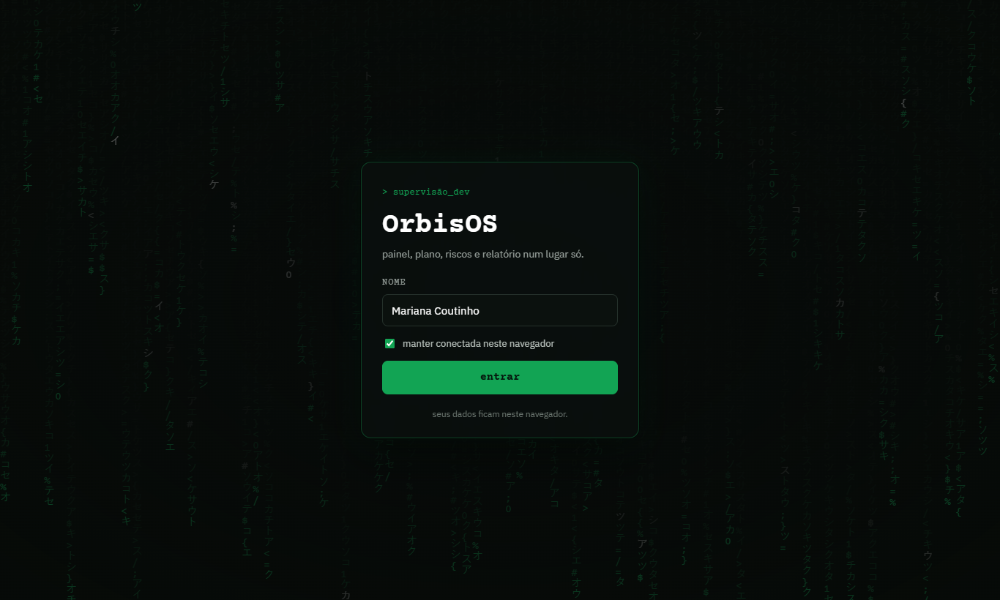
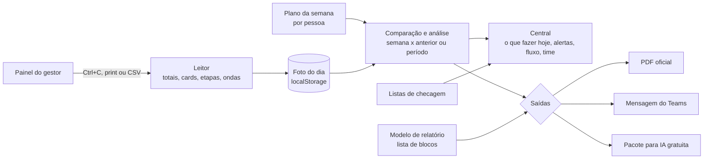

# OrbisOS

Ferramenta de supervisão do time de desenvolvimento. Transforma o que o painel do gestor mostra (Ctrl+C, print da tela ou o CSV da lista de Demandas) em acompanhamento semanal, alertas de fluxo e relatórios em PDF.

No ar: https://orbisos-eta.vercel.app




## O nome

*Orbis* é "mundo" em latim, e *OS* vem de *operating system*. O OrbisOS é o sistema operacional do meu mundo de trabalho: painel, plano, riscos e relatório num lugar só. Tudo gira em volta da semana, como uma órbita, com o mesmo ciclo de segunda a sexta.

## Ideia

- O painel do gestor é a fonte da verdade. O OrbisOS só lê e compara os números; nunca recalcula o que o painel já mostra.
- A entrada é um Ctrl+C da tela, um print (lido no navegador pelo tesseract.js) ou o CSV exportado da lista de Demandas.
- Roda no navegador. Os dados ficam no localStorage, com backup em .json e sincronização opcional no Firebase. A tela de entrada só identifica quem usa; a proteção de verdade é o login Google do Firebase.
- Tudo gratuito: nenhuma API paga e nenhuma IA paga. A ponte com IA é opcional: copiar um texto e colar num chat gratuito.

## Como funciona



A semana segue o ciclo da central: segunda cola o painel e confirma o plano; terça a quinta acompanha; sexta cola de novo e fecha. A central também mostra o **fluxo**: tempo de entrega por prioridade (p50 e p85), demandas paradas além do normal, onde as demandas se acumulam, a projeção da meta de prazo no fim do mês e o que vence em até 2 dias úteis. O relatório sai de um **modelo**: uma lista de blocos (seções prontas, texto, gráfico, tabela, quebra de página). Os modelos prontos são Semanal completo, Executivo e Período (do dia X ao dia Y).

## Estrutura

```
packages/core      regras puras em TypeScript, sem DOM, com testes (vitest)
  src/leitor/      lê o painel: totais, cards, etapas do card, ondas e o CSV de demandas
  src/fluxo.ts     tempo de entrega, parados, gargalos, projeção da meta e vencimentos
  src/checklist.ts listas de checagem
  src/modelo.ts    modelos de relatório prontos e validação de modelos importados
apps/relatorio     SvelteKit (Svelte 5, adapter-static)
  routes/          entrar, central, colar painel, cards, semana, relatório, modelos, listas
  lib/pdf.ts       monta o PDF com pdfmake, bloco por bloco
  lib/ocr.ts       prepara o print e roda o tesseract.js
```

Cálculo fica no core; o app só exibe e grava.

## Rodar

```
npm install
npm run dev       # app em http://localhost:5173
npm test          # testes do core
npm run check     # tipos (tsc e svelte-check)
npm run build     # site estático em apps/relatorio/build
```

Publicação: projeto **orbisos** na Vercel, ligado a este repositório. Cada envio para a main publica sozinho; a configuração está em [vercel.json](vercel.json).

## Nuvem (Firebase, opcional)

O navegador é a cópia de trabalho (localStorage). Com o Firebase ligado, cada mudança vai para o Firestore 2 s depois. Ao abrir o app, a versão mais nova vence; num navegador novo, a nuvem vence e o que havia ali é baixado como backup.

1. Em console.firebase.google.com, crie um projeto (plano Spark, gratuito).
2. Em Authentication, ative o provedor Google.
3. Em Firestore Database, crie o banco e cole as regras de [firestore.rules](firestore.rules).
4. Em Configurações do projeto > Seus apps, crie um app Web e copie a configuração para [apps/relatorio/src/lib/firebaseConfig.ts](apps/relatorio/src/lib/firebaseConfig.ts).
5. Em Authentication > Configurações > Domínios autorizados, adicione `orbisos-eta.vercel.app`.

Estrutura: `usuarios/{uid}/geral/dados` guarda tudo menos as fotos, e `usuarios/{uid}/fotos/{data}` guarda uma foto do painel por documento. A configuração do app web não é segredo; quem protege os dados são as regras.

## Convenções

- Nomes em português, chaves de bloco na linha de baixo, TypeScript estrito sem `any`.
- Modelo de relatório novo por código: mais um objeto em `modelosProntos` ([packages/core/src/modelo.ts](packages/core/src/modelo.ts)).
- Leitura de tela nova: acrescente o caso nos testes de [packages/core/src/leitor](packages/core/src/leitor) com o texto real colado do painel.
