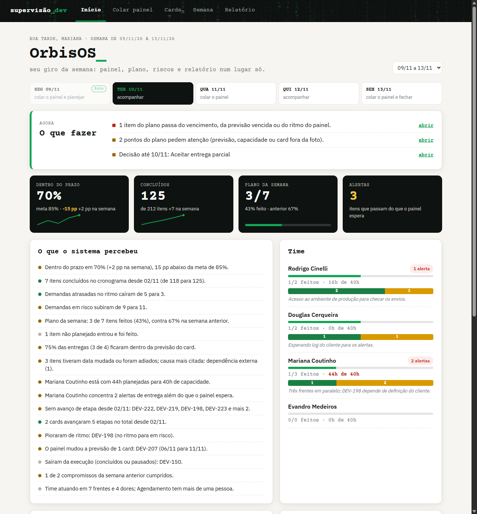
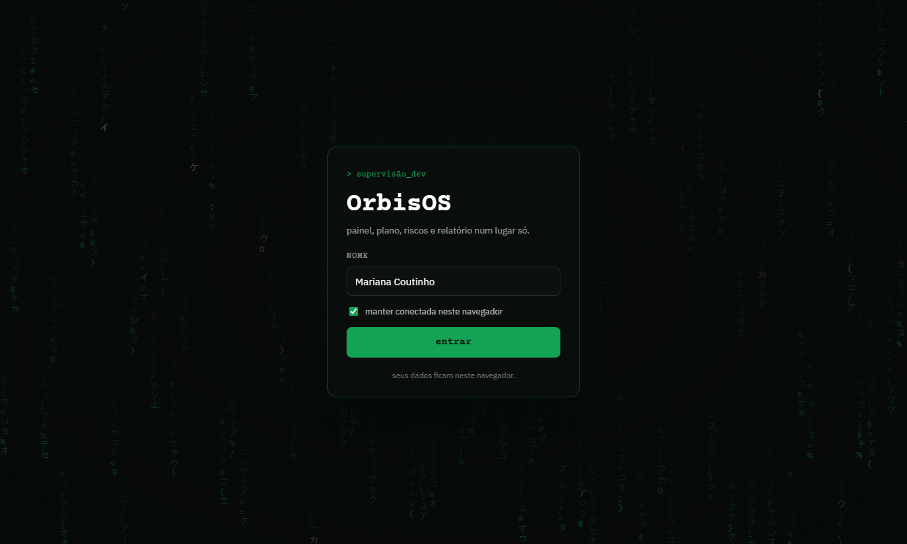
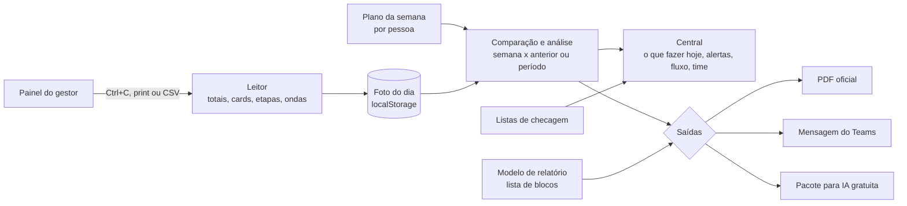

# OrbisOS

Ferramenta de supervisão do time de desenvolvimento. Transforma o que o painel do gestor mostra (Ctrl+C, print da tela ou o CSV da lista de Demandas) em acompanhamento semanal, alertas de fluxo e relatórios em PDF.

No ar: https://orbisos-eta.vercel.app





## O nome

*Orbis* é "mundo" em latim, e *OS* vem de *operating system*. O OrbisOS é o sistema operacional do meu mundo de trabalho: painel, plano, riscos e relatório num lugar só. Tudo gira em volta da semana, como uma órbita, com o mesmo ciclo de segunda a sexta.

## Ideia

- O painel do gestor é a fonte da verdade. O OrbisOS só lê e compara os números; nunca recalcula o que o painel já mostra.
- A entrada é um Ctrl+C da tela, um print (lido no navegador pelo tesseract.js) ou o CSV exportado da lista de Demandas.
- Roda no navegador. Os dados ficam no localStorage, com backup em .json e sincronização opcional no Firebase. Sem Firebase, a tela de entrada só identifica quem usa. Com ele, vira conta de verdade (e-mail e senha), e a proteção dos dados são as regras do Firestore.
- Tudo gratuito: nenhuma API paga e nenhuma IA paga. A ponte com IA é opcional: copiar um texto e colar num chat gratuito.

## Como funciona



A semana segue o ciclo da central: segunda cola o painel e confirma o plano; terça a quinta acompanha; sexta cola de novo e fecha. A central também mostra o **fluxo**: tempo de entrega por prioridade (p50 e p85), demandas paradas além do normal, onde as demandas se acumulam, a projeção da meta de prazo no fim do mês e o que vence em até 2 dias úteis. O relatório sai de um **modelo**: uma lista de blocos (seções prontas, texto, gráfico, tabela, quebra de página). Os modelos prontos são Semanal completo, Executivo, Período (do dia X ao dia Y), Fechamento do mês, Riscos e decisões, Fluxo e previsão, Diário de implantação, Implantação por fase, Processos (fluxogramas) e Interativo.

A tela **Fluxos** desenha fluxogramas de processo: monte por passos em texto, cole um Mermaid de uma IA gratuita ou arraste as peças no editor. Os fluxos entram no PDF pelo bloco Fluxograma. O modelo **Interativo** pode ser publicado como **link**: quem recebe lê no navegador, marca Ciente, Concordo ou Dúvida em cada ponto e comenta, sem criar conta, e as respostas chegam na tela **Retornos**.

A tela **Vivos** guarda relatórios que ficam abertos: checklist com itens que zeram todo dia, registros por data que viram os campos do relatório e botão para abrir no Relatório com o período certo. A **Visão do mês** resume o mês (prazo semana a semana, time, compromissos) e gera o relatório do mês. O modelo **1:1 por pessoa** faz uma página por pessoa. **Ctrl+K** abre a paleta de comandos (telas, ações, listas, fluxos, vivos e cards) e a tela **Roadmap** mostra o que vem em 2027.

### IA local (opcional)

Os campos de texto do Relatório têm "escrever rascunho com IA local". Ela roda no navegador pelo WebLLM (WebGPU, Chrome ou Edge), sem servidor e sem custo: o modelo Qwen2.5 1.5B baixa uma vez (cerca de 1 GB) e fica guardado. Recebe só o pacote de fatos conferido e o sistema avisa se o texto trouxer um número que não está nele. Continua valendo: nenhuma IA paga.

## Estrutura

```
packages/core      regras puras em TypeScript, sem DOM, com testes (vitest)
  src/leitor/      lê o painel: totais, cards, etapas do card, ondas e o CSV de demandas
  src/fluxo.ts     tempo de entrega, parados, gargalos, projeção da meta e vencimentos
  src/checklist.ts listas de checagem
  src/vivo.ts      relatório vivo: checklist diário e registros por campo
  src/modelo.ts    modelos de relatório prontos e validação de modelos importados
apps/relatorio     SvelteKit (Svelte 5, adapter-static)
  routes/          entrar, central, colar painel, cards, semana, relatório, modelos, listas, fluxos, vivos, mes, roadmap, perfil, retornos, ler (link recebido)
  lib/pdf.ts       monta o PDF com pdfmake, bloco por bloco
  lib/ocr.ts       prepara o print e roda o tesseract.js
```

Cálculo fica no core; o app só exibe e grava.

## Rodar

```
npm install
npm run dev       # app em http://localhost:5173
npm test          # testes do core
npm run check     # tipos (tsc e svelte-check)
npm run build     # site estático em apps/relatorio/build
```

Publicação: projeto **orbisos** na Vercel, ligado a este repositório. Cada envio para a main publica sozinho; a configuração está em [vercel.json](vercel.json).

## Nuvem (Firebase, opcional)

O navegador é a cópia de trabalho (localStorage). Com o Firebase ligado, cada mudança vai para o Firestore 2 s depois. Ao abrir o app, a versão mais nova vence; num navegador novo, a nuvem vence e o que havia ali é baixado como backup.

1. Em console.firebase.google.com, crie um projeto (plano Spark, gratuito).
2. Em Authentication, clique em Começar e ative o provedor E-mail/senha.
3. Em Firestore Database, crie o banco e cole as regras de [firestore.rules](firestore.rules).
4. Em Configurações do projeto > Seus apps, crie um app Web e copie a configuração para [apps/relatorio/src/lib/firebaseConfig.ts](apps/relatorio/src/lib/firebaseConfig.ts).
5. Em Authentication > Configurações > Domínios autorizados, adicione `orbisos-eta.vercel.app`.

Links interativos: `publicados/{codigo}` guarda o relatório publicado e `publicados/{codigo}/respostas/{id}` as marcas e comentários. O código do link tem 24 letras e números e é o segredo; desativar o link na tela Retornos tira o acesso na hora. As regras deixam qualquer pessoa com o link criar respostas (sem editar nem apagar) e só a dona ler tudo.

Estrutura: `usuarios/{uid}/geral/dados` guarda tudo menos fotos e registros; `usuarios/{uid}/fotos/{id}` guarda uma foto do painel por documento (o id é a data; fora do DEV vira `PASTA__data`); `usuarios/{uid}/registros/{id}` guarda um registro do diário por documento; `usuarios/{uid}/imagens/{id}` guarda uma imagem de print por documento (JPEG em data URL, sempre abaixo de 1 MB). Assim nenhum documento chega perto do limite de 1 MB do Firestore, e os registros guardam só o `imagemId`. O cache local do Firestore (IndexedDB) mantém o que já foi baixado, inclusive as imagens, e reenvia o que ficou pendente offline. A configuração do app web não é segredo; quem protege os dados são as regras.

Não há servidor próprio: o app é TypeScript de ponta a ponta (SvelteKit estático na Vercel) e o backend é o Firebase (Authentication e Firestore), protegido pelas regras de [firestore.rules](firestore.rules).

### Espaços compartilhados, convites e papéis (fase 1)

Os dados continuam em `usuarios/{donoUid}`; quem foi convidado abre o espaço do dono em vez do próprio. A lógica pura (e-mail, papéis, convite, aceite, revogação) está em [packages/core/src/acesso.ts](packages/core/src/acesso.ts), com testes; o acesso ao Firestore está em [apps/relatorio/src/lib/acesso.ts](apps/relatorio/src/lib/acesso.ts) e a tela em Gerenciamento de pessoas, seção Acesso e convites.

- `convites/{email__donoUid}`: convite feito pelo dono (e-mail em minúsculo, papel, projetos, status pendente, aceito ou revogado). O convidado lê os convites do próprio e-mail.
- `usuarios/{donoUid}/membros/{membroUid}`: quem já entrou. O convidado cria o próprio documento só se houver convite pendente com o mesmo papel e projetos; só o dono altera ou remove. Cada membro lê apenas o próprio documento.
- Papéis: **dono** faz tudo; **supervisor** lê e grava os dados do dono, mas não gerencia a equipe; **leitor** só lê (a tela mostra a faixa Somente leitura e nada é salvo, nem no navegador).
- Fluxo: o dono convida pelo e-mail; a pessoa entra no OrbisOS com esse e-mail, aceita o convite e escolhe o espaço no seletor. O espaço escolhido fica em `localStorage` (`orbisos-espaco`) e a página recarrega; cada espaço tem cópia local própria. Revogar apaga o documento de membro e marca o convite como revogado; o membro também pode sair sozinho.

O que **não** foi testado: nada disso rodou contra o Firebase real nem contra o emulador. Foram testados só a lógica pura (vitest) e os tipos (`npm run check`); as regras novas foram escritas e relidas, mas nunca executadas. Limites conhecidos:

- Os projetos liberados no convite só filtram o que a tela mostra; as regras não separam por projeto, então um membro com acesso ao espaço consegue ler tudo do dono pelo Firestore.
- O e-mail do convite é conferido pelo e-mail da conta, mas o app não exige e-mail verificado; quem criar conta com o e-mail convidado antes da pessoa certa receberia o convite. Verificar o e-mail antes de aceitar fica para a próxima fase.
- Vale a última gravação: se o dono e um supervisor editarem ao mesmo tempo, a mais recente vence (como já era entre dois navegadores).
- Links publicados (`publicados/{codigo}`) continuam pertencendo a quem os publica; o leitor não publica.

## Convenções

- Nomes em português, chaves de bloco na linha de baixo, TypeScript estrito sem `any`.
- Modelo de relatório novo por código: mais um objeto em `modelosProntos` ([packages/core/src/modelo.ts](packages/core/src/modelo.ts)).
- Leitura de tela nova: acrescente o caso nos testes de [packages/core/src/leitor](packages/core/src/leitor) com o texto real colado do painel.
